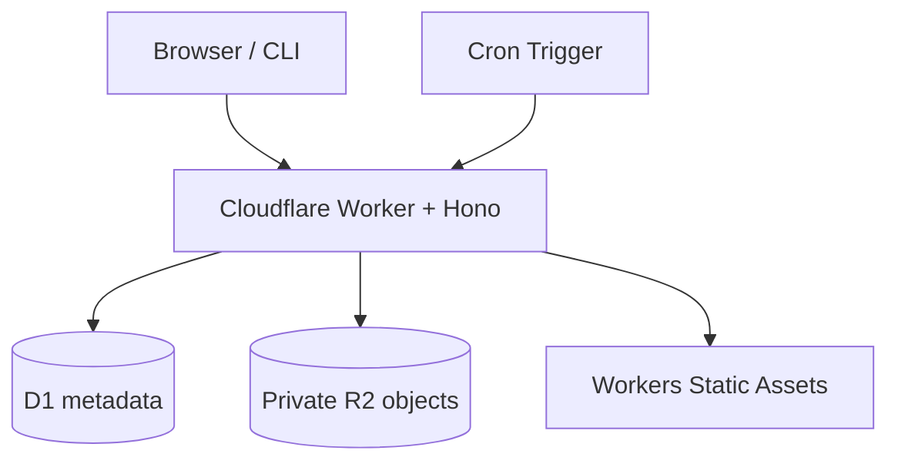
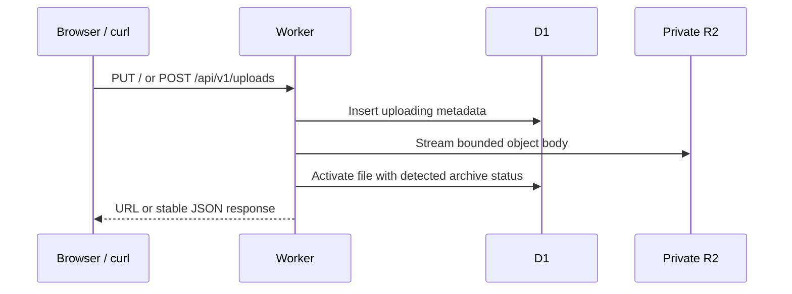
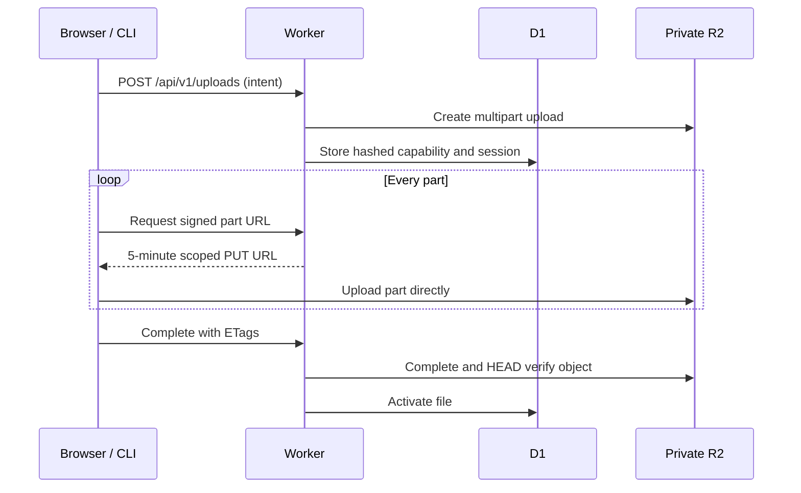
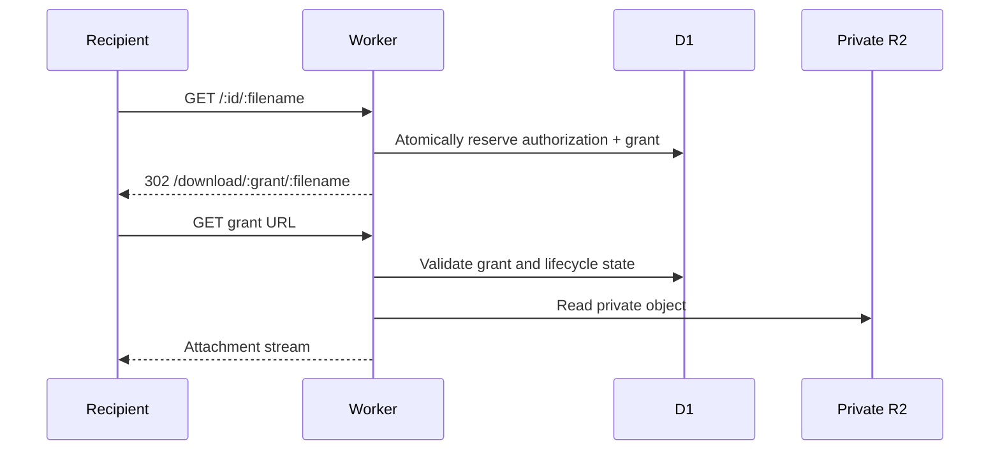

# Architecture

free-locker uses one asset-first Worker. Vite assets are served directly; `/`, `/api/*`, dynamic download paths, and Cron cleanup run Worker code.

## Small uploads

`PUT /` and raw `POST /api/v1/uploads` stream a request body into R2. The Worker rejects a body above the configured limit before it becomes active. D1 metadata starts in `uploading`; only a successful R2 write changes it to `active`.

The direct path requires `Content-Length`, because R2 streaming writes require a known length. The application caps it below Cloudflare Free's 100 MB zone request limit.

## Multipart uploads

For large files, the browser or CLI creates an upload session, requests one signed R2 `UploadPart` URL at a time, sends parts directly to R2, and submits ordered ETags to the Worker. Parent R2 credentials never reach a client.

R2 presigned multipart part URLs must be validated against a real bucket before production rollout. The implementation fails closed with `MULTIPART_UNAVAILABLE` when signing credentials are absent.

## Downloads

Share links are not R2 URLs. A `GET /:id/:filename` atomically reserves an allowance and redirects to a 10-minute grant. Grant requests can use Range headers for retry/resume. `HEAD` reads safe metadata and never consumes an allowance.

This enforces five distinct authorizations. It does not claim that the Worker can prove every client received all bytes after a stream begins; a grant may serve retry/range requests during its 10-minute lifetime.
